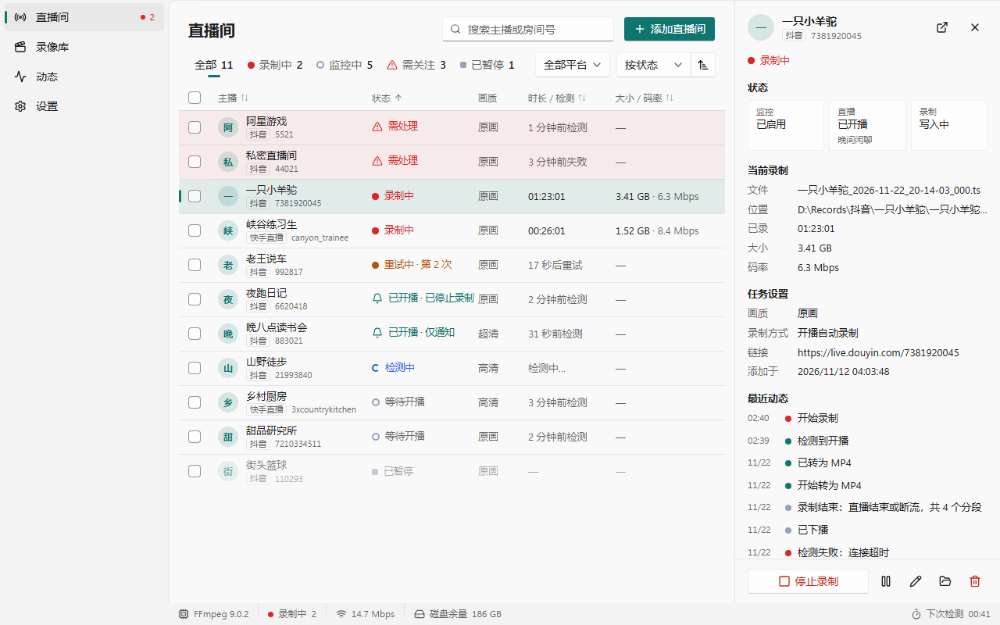
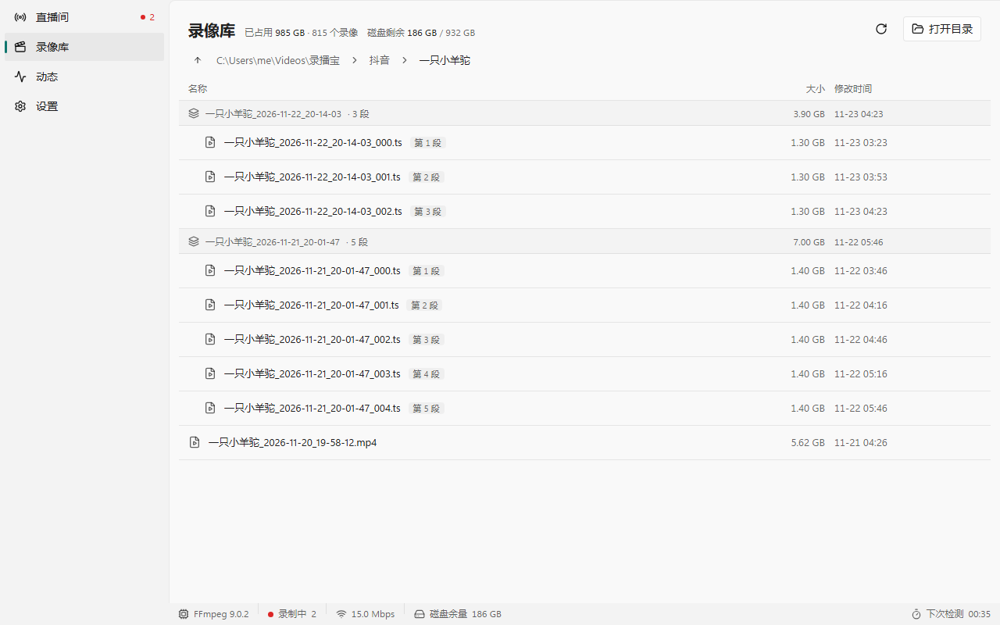
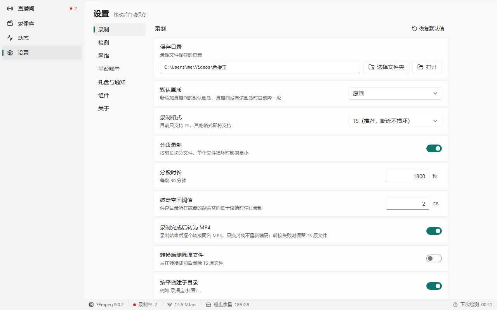

# 录播宝 LuBoBao

**开播自动录，不用再蹲直播。**

录播宝是一个开源的直播录制工具。添加抖音、快手、B站、TikTok、YouTube 等平台的直播间后，它在后台定时检测，主播开播就用 FFmpeg 开始录制，下播后自动收尾，录像保存在你自己的电脑或服务器上。提供 Windows、macOS、Linux 桌面版，以及无界面的命令行版和 Docker 镜像。

> 当前是 0.2 公测版。安装包没有购买代码签名证书，第一次打开时系统会提示，见[首次打开](#首次打开)。



## 功能

- **开播自动录制**：按设定的间隔检测直播状态，开播即录，下播后收尾。断流后重新检测、接着录；手动停止的直播间保持停止，不会被重新拉起。每个平台的同时检测数有上限，检测失败时退避重试。
- **25 个平台**：国内有抖音、快手、B站、虎牙、斗鱼、小红书、YY、网易CC、微博、AcFun、花椒、映客、酷狗、六间房、百度、知乎、猫耳FM；海外有 TikTok、Twitch、YouTube、SOOP（AfreecaTV）、CHZZK、TwitCasting、ShowRoom、17Live。可以直接粘贴整段分享文字，自动找出其中的链接，抖音号、主页链接和各平台短链也能识别。画质分原画、超清、高清、标清、流畅五档，所选画质取流失败时自动换一档。可以按平台设置代理和 Cookie；海外平台在中国大陆需要走代理。YouTube 第一次检测到开播时在后台下载 yt-dlp 和 Deno（校验后安装），建议填写 YouTube Cookie。
- **直播间管理**：任务表显示录制中、检测中、等待开播、重试中、仅通知、需处理、已暂停等状态，可排序、按平台和状态筛选、搜索，多选后批量暂停、恢复和删除。添加时识别链接并提示重复。选中一项后在右侧查看监控、直播、录制三种状态、当前录制和最近动态。
- **仅通知模式**：只想知道开没开播的直播间可以设为「仅通知」，开播时发系统通知，不录制。
- **分段录制、录后转 MP4**：录制时写入 TS 分段，中途断开也能保留已录的部分。录完后逐个转成 MP4（只换封装、不重新编码），确认能读取后才替换；默认保留 TS 原文件，转换失败时原文件不动。
- **录像库与动态**：在录像库里按目录浏览录像，同一场录制的分段放在一起，可用系统播放器打开或在文件夹中显示。动态页按时间列出开播、下播、录制、转换和出错记录，可按直播间和类型筛选，重启后仍在。
- **后台常驻**：关闭窗口时可以选择收到托盘，录制照常进行；托盘菜单可以全部暂停或恢复监控。有录制时退出会先确认，等文件写完再退出。开播、录制失败时发系统通知。
- **FFmpeg 自动安装**：第一次启动时在后台下载与系统匹配的 FFmpeg，优先国内源，按固定的 SHA-256 校验后才安装。下载期间界面照常可用，装好后断网也能复用。
- **应用内更新**：在「设置 → 关于」检查更新，也可以开启自动检查。更新包校验签名后才安装；有录制时先确认，收尾后再安装并重启。

| 录像库 | 设置 |
| --- | --- |
|  |  |

截图来自浏览器中的假数据界面（Windows 浅色主题；macOS、Linux 上界面随系统风格），直播间均为虚构示例。

## 下载

官网：<https://lubobao.xiaofany.com>（自动识别系统并给出下载按钮）。备用下载：[GitHub Releases](https://github.com/seansongx/lubobao/releases)，每个版本附 `SHA256SUMS.txt`。

| 系统 | 安装包 |
| --- | --- |
| Windows 10 / 11（x64） | `.exe` 安装程序 |
| macOS 10.15 及以后（Apple 芯片、Intel 芯片） | 一键安装命令，或手动下载 `.dmg` |
| Linux 桌面（x64） | AppImage、deb |
| Linux 服务器（x64、arm64） | 命令行版 `lubobao-cli`、Docker 镜像，见下文 |

macOS 推荐在「终端」里运行一键安装命令。脚本按芯片下载对应版本，校验 SHA-256 后装进「应用程序」并去掉隔离标记，打开时不会被拦截：

```sh
curl -fsSL https://lubobao.xiaofany.com/install.sh | sh
```

### 首次打开

安装包还没有代码签名，系统第一次打开时会提示来源未知，放行一次即可。详细步骤见官网的[首次打开](https://lubobao.xiaofany.com/#first-run)。

- **Windows**：SmartScreen 提示「Windows 已保护你的电脑」时，点「更多信息」→「仍要运行」。
- **macOS（手动安装的 dmg）**：macOS 15 及以后，第一次打开被拦截后到「系统设置 → 隐私与安全性」底部点「仍要打开」；macOS 14 及更早，在「应用程序」里按住 Control 点按「录播宝」，选「打开」。提示「已损坏，无法打开」时，在终端执行 `xattr -dr com.apple.quarantine /Applications/录播宝.app` 后重新打开。

## 服务器 / 命令行

`lubobao-cli` 是录播宝的无界面版本，和桌面版用同一套录制核心，适合放在 Linux 服务器、NAS 或容器里长期运行。没有窗口和托盘，事件写进日志。

```sh
# 安装（按 CPU 架构下载并校验 SHA-256）
curl -fsSL https://lubobao.xiaofany.com/install-cli.sh | sh

# 前台常驻：监控并自动录制
lubobao-cli run

# 另开一个终端添加直播间、查看状态
lubobao-cli add https://live.douyin.com/123456
lubobao-cli list
```

Docker 镜像 `ghcr.io/seansongx/lubobao` 支持 amd64 和 arm64，内置已校验的 FFmpeg：

```sh
docker run -d --name lubobao --restart unless-stopped --stop-timeout 45 \
  -e TZ=Asia/Shanghai \
  -v lubobao-data:/data -v lubobao-recordings:/recordings \
  ghcr.io/seansongx/lubobao:latest

docker exec lubobao lubobao-cli add https://live.douyin.com/123456
```

全部子命令、数据目录、设置、systemd 服务和 Docker Compose 示例见[命令行文档](docs/cli.md)。

## 从源码构建

需要 Node.js、npm 和 Rust 稳定版。Windows 还需要 WebView2 Runtime 和 Microsoft C++ Build Tools（含「使用 C++ 的桌面开发」工作负载和 Windows SDK）；Linux 需要 WebKitGTK 等系统库，见 [Tauri 的环境要求](https://v2.tauri.app/start/prerequisites/)。

```sh
npm ci
npm run tauri dev        # 启动桌面应用（开发模式）
npm run dev              # 只启动前端，在浏览器里用假数据调界面：http://127.0.0.1:1420
cargo run -p lubobao-cli -- run --data-dir ./tmp-data   # 运行命令行版
```

打包桌面安装包（输出到 `target/release/bundle/`）。本地没有更新签名私钥时，关掉更新包：

```sh
npm run tauri build -- --config '{"bundle":{"createUpdaterArtifacts":false}}'
```

## 参与开发

- 仓库结构、技术选型、代码风格、测试和提交前检查见 [AGENTS.md](AGENTS.md)。
- 功能范围、验收状态和与 StreamCap 的有意差异见[功能地图](docs/specs/feature-map.md)。
- 发版流程见 [docs/specs/release.md](docs/specs/release.md)。fork 后自己发版时，要把 `src-tauri/tauri.conf.json` 里 `plugins.updater` 的更新接口（xiaofany.com 和 GitHub `latest.json` 两个地址）和公钥 `pubkey` 换成自己的，否则装了你的版本的用户会从本仓库检查更新，签名也对不上。
- 平台解析参考了 [StreamGet](https://github.com/ihmily/streamget)，界面和功能参考了 [StreamCap](https://github.com/ihmily/StreamCap)。

## 许可证

录播宝以 [MIT 许可证](LICENSE) 发布。移植或参考的第三方代码及其许可证列在 [THIRD_PARTY_NOTICES.md](THIRD_PARTY_NOTICES.md)。

录播宝的安装包不包含 FFmpeg：运行时从 npm 包 [`@seankit/ffmpeg`](https://www.npmjs.com/package/@seankit/ffmpeg) 下载校验过的 FFmpeg 构建，作为独立程序调用。这些构建以 GPL-3.0-or-later 发布，包内附有许可证和对应源代码的位置。Docker 镜像内置同一构建，位于 `/opt/ffmpeg/`，许可证文件在旁边。
